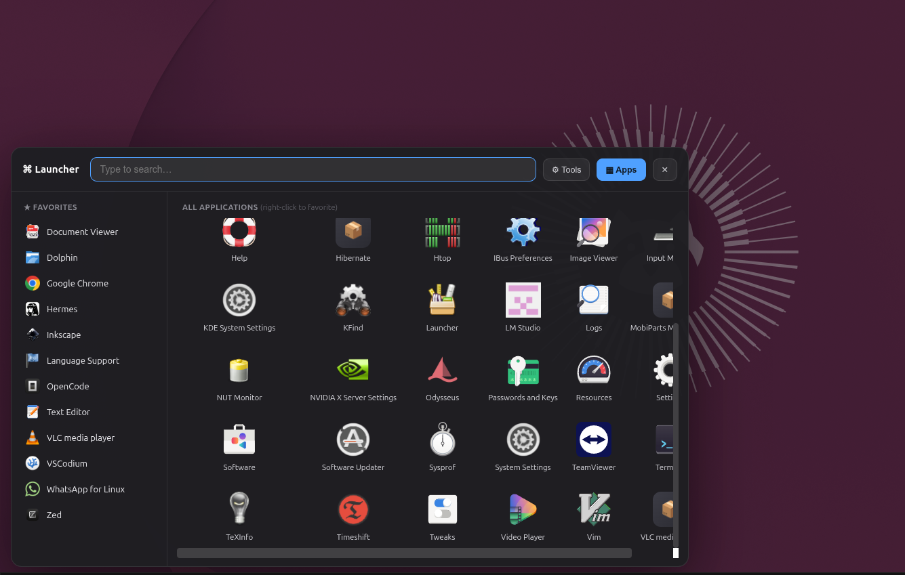

#  Glass Launcher

> 🚧 **v0.9 in progress** — M1/P2: the 3-column *Start Menu* layout is being built right now.
> Stable P1 release: [`glass-m1-p1-stable`](https://github.com/Prog71/Public/tree/glass-m1-p1-stable)

**Glass Launcher** is a beautiful, Wayland-compatible, glass-effect app launcher for Linux. 

Unlike traditional launchers that fight with window managers, Glass Launcher uses a transparent, hardware-accelerated window with smooth CSS animations to deliver a buttery-smooth, macOS-style "drop-up" experience.

## ✨ Key Features

- **Real Glassmorphism:** Transparent, blurred background with your live desktop showing through.
- **Wayland & X11 Compatible:** Works perfectly on modern Linux distributions without fighting the window manager.
- **Smart Favorites:** Right-click any app to pin it — pinned apps live in their own dedicated **PINNED** column.
- **Embedded Console Drawer:** Run system tools and watch output stream live — expands for long logs, tucks away when you switch to Apps, and shows a live dot on the Tools tab.
- **Drop-in Plugin System:** Add your own custom tools simply by dropping a `.json` file.
- **Keyboard First:** `Arrow keys` to navigate, `Enter` to launch, `Escape` to dismiss.

<video src="demo.mp4" controls width="100%"></video>

## 📸 Screenshots

### The Apps Tab & Smart Favorites


### Smart Right-Click Menus


### The Clean Tools Tab


### Add Tool: Select System App


### Add Tool: Import Custom Script


## 🚀 Installation

We made it easy! You don't need to be a developer to use this.

1. **Download the code**:
   Click the green **<> Code** button at the top of this page and select **Download ZIP**.

2. **Extract the ZIP file**:
   Double-click the downloaded ZIP file to extract it. (GitHub will name the folder something like `Public-main`).

3. **Open the folder in Terminal**:
   Open the extracted folder. Right-click anywhere in the empty space of the folder and select **"Open in Terminal"**.

4. **Run the setup**:
   In the terminal that opens, type these two commands and press Enter:
   ```bash
   chmod +x setup-glass.sh
   ./setup-glass.sh
   ```

5. **That's it!** The setup script:
   - Deploys the app to `~/.local/share/system-launcher` and installs its dependencies.
   - Installs `/usr/local/bin/launcher-toggle` (starts the app hidden on login and toggles it on every run).
   - Pins `glass-launcher-toggle.desktop` as the first dock favorite.
   - Sets dash-to-dock `show-running=false` so only the pinned icon ever shows (no duplicate window icon).
   - Registers the **`Super+Space`** keyboard shortcut (GNOME).

## 🖱️ How the dock toggle works (integrators' note)

Three pieces work together — the setup script configures all of them:

1. **Resident single instance.** The runtime copy lives in `~/.local/share/system-launcher`.
   Autostart runs `launcher-toggle` with `LAUNCHER_HIDDEN=1`, so one instance stays resident.
   Every further run (dock click, `Super+Space`) becomes Electron's `second-instance` event
   in the resident process, which calls `toggleWin()`.
2. **A dedicated, uniquely-named pin.** `glass-launcher-toggle.desktop` is pinned first in
   `favorite-apps`. Its identity never groups with the popup window, so every dock left-click
   *launches* (→ toggle) instead of merely focusing the window — the Windows Start-button behavior.
3. **`show-running=false`** hides running-but-unpinned icons, so the popup's window never
   appears as a second icon next to the pin.

## 🗑️ Uninstall

```bash
sudo rm -f /usr/local/bin/launcher-toggle
rm -rf ~/.local/share/system-launcher \
       ~/.local/share/applications/glass-launcher-toggle.desktop \
       ~/.config/autostart/system-launcher.desktop
```
Then right-click the dock pin → *Remove from Favorites*.

