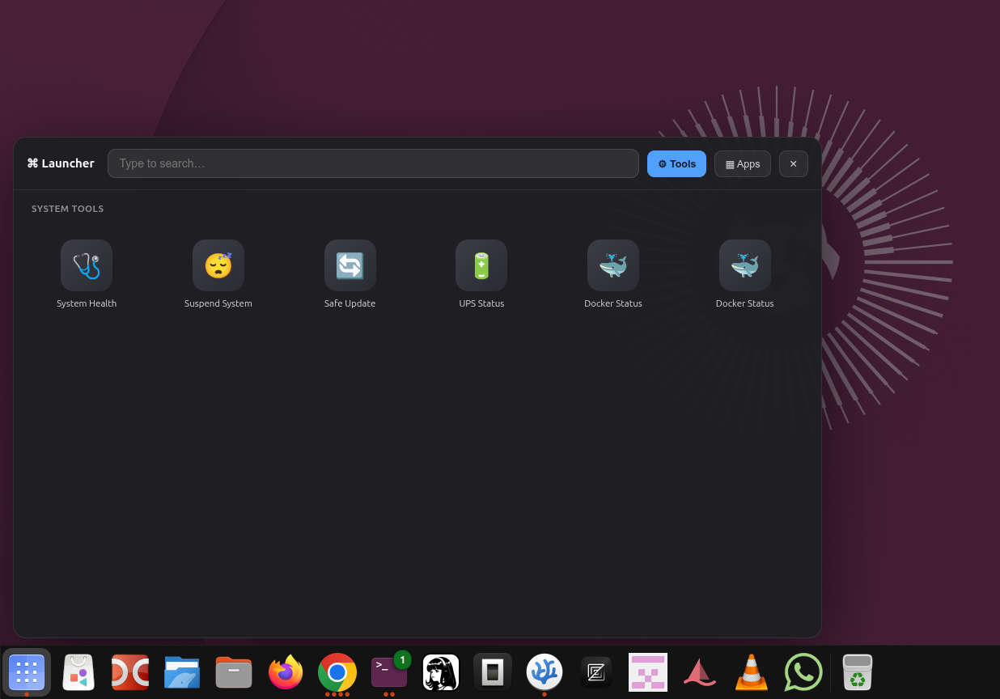

#  Glass Launcher

**Glass Launcher** is a beautiful, Wayland-compatible, glass-effect app launcher for Linux. 

Unlike traditional launchers that fight with window managers, Glass Launcher uses a transparent, hardware-accelerated window with smooth CSS animations to deliver a buttery-smooth, macOS-style "drop-up" experience.

## ✨ Key Features

- **Real Glassmorphism:** Transparent, blurred background with your live desktop showing through.
- **Wayland & X11 Compatible:** Works perfectly on modern Linux distributions without fighting the window manager.
- **Smart Favorites:** Right-click any app to pin it. Pinned apps get their own dedicated sidebar.
- **Embedded Console Drawer:** Run system maintenance tools and watch the output stream live inside the launcher.
- **Drop-in Plugin System:** Add your own custom tools simply by dropping a `.json` file.
- **Keyboard First:** `Arrow keys` to navigate, `Enter` to launch, `Escape` to dismiss.

## 📸 Screenshots

### The Main Grid & Favorites


### The System Tools Tab


### Smart Right-Click Menus


##  Installation

1. **Install Node.js and npm**:
   ```bash
   sudo apt update && sudo apt install nodejs npm -y
