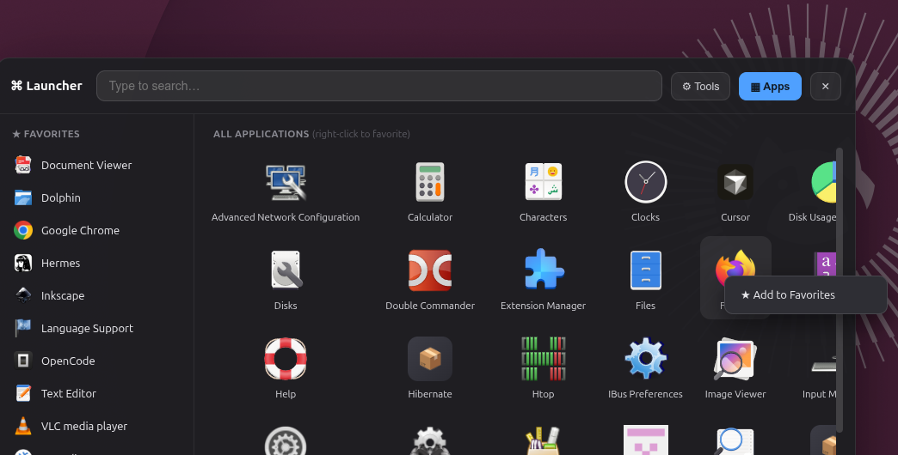
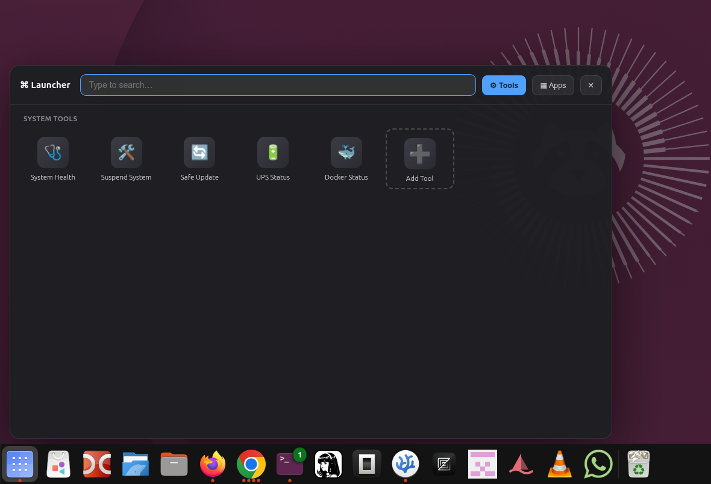
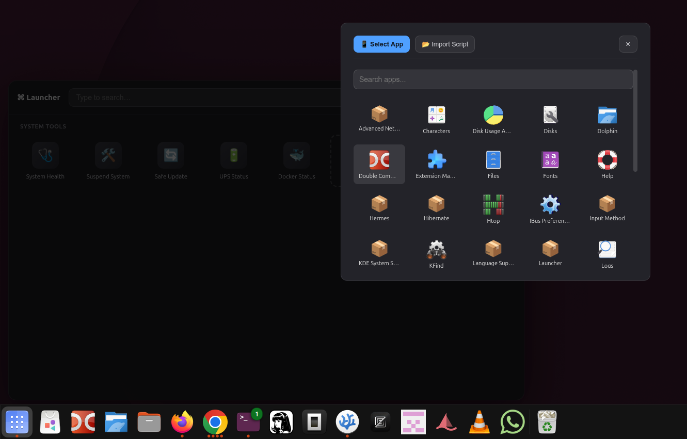
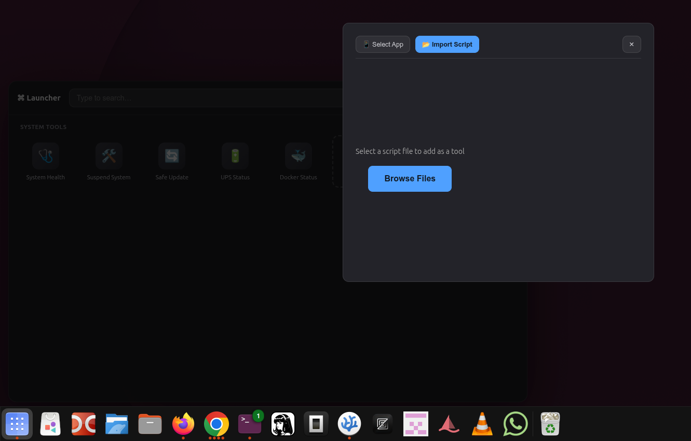

#  Glass Launcher

**Glass Launcher** is a beautiful, Wayland-compatible, glass-effect app launcher for Linux. 

Unlike traditional launchers that fight with window managers, Glass Launcher uses a transparent, hardware-accelerated window with smooth CSS animations to deliver a buttery-smooth, macOS-style "drop-up" experience.

## ✨ Key Features

- **Real Glassmorphism:** Transparent, blurred background with your live desktop showing through.
- **Wayland & X11 Compatible:** Works perfectly on modern Linux distributions without fighting the window manager.
- **Smart Favorites:** Right-click any app to pin it. Pinned apps get their own dedicated sidebar.
- **Embedded Console Drawer:** Run system maintenance tools and watch the output stream live inside the launcher.
- **Drop-in Plugin System:** Add your own custom tools simply by dropping a `.json` file.
- **Keyboard First:** `Arrow keys` to navigate, `Enter` to launch, `Escape` to dismiss.

<video src="demo.mp4" controls width="100%"></video>

## 📸 Screenshots

### The Apps Tab & Smart Favorites


### Smart Right-Click Menus


### The Clean Tools Tab


### Add Tool: Select System App


### Add Tool: Import Custom Script


<video src="demo.mp4" controls width="100%"></video>

## 🚀 Installation

We made it easy! You don't need to be a developer to use this.

1. **Download the code**:
   Click the green **<> Code** button at the top of this page and select **Download ZIP**.

2. **Extract the ZIP file**:
   Double-click the downloaded ZIP file to extract it. (GitHub will name the folder something like `Public-main`).

3. **Open the folder in Terminal**:
   Open the extracted folder. Right-click anywhere in the empty space of the folder and select **"Open in Terminal"**.

4. **Run the setup**:
   In the terminal that opens, type these two commands and press Enter:
   ```bash
   chmod +x setup-glass.sh
   ./setup-glass.sh
